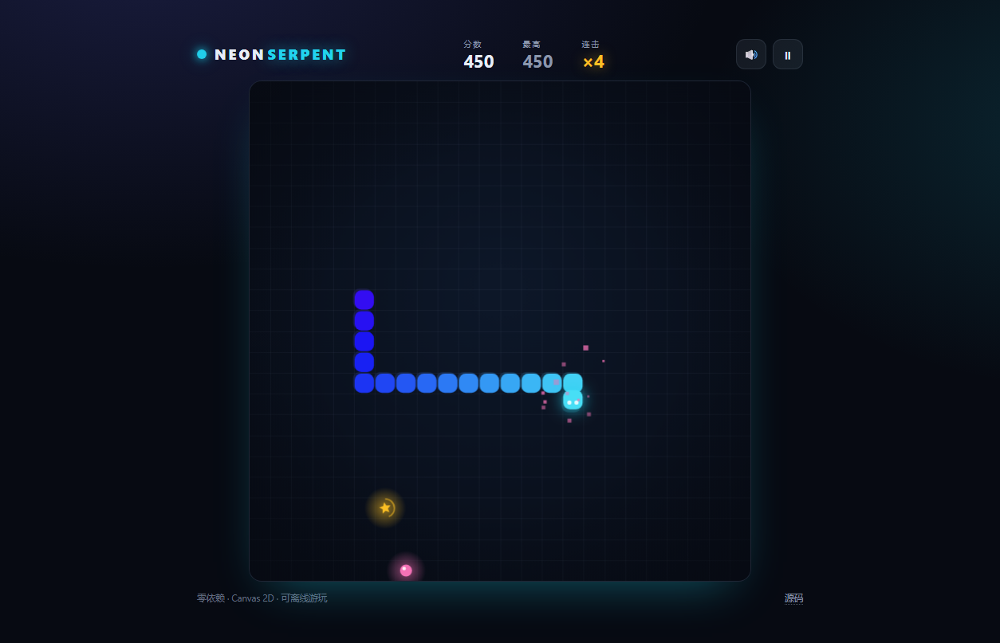

# Neon Serpent · 霓虹贪吃蛇

一个零依赖、纯 Canvas 2D 的小游戏。没有框架、没有构建、没有图片和音频资源——美术是代码画的，音效是 WebAudio 现场合成的。

**在线试玩：<https://hh200606.github.io/neon-serpent/>**



---

## 玩法

| 操作 | 键位 |
| :--- | :--- |
| 移动 | `↑ ↓ ← →` / `W A S D` / 手机滑动屏幕 / 屏幕方向键 |
| 暂停 | `空格` |
| 重开 | `R` |
| 音效 | `M` |

- **粉色果实** +10 分，身体长一节，速度提升；
- **金色果实** +30 分，每吃 5 个果实出现一次，只停留 9 秒；
- **连击**：2.6 秒内连续吃到果实，倍率 +1，最高 ×5 —— 分差的真正来源；
- 撞墙或咬到自己即结束，最高分存在 `localStorage`。

## 特性

- **固定步长 + 渲染插值**：逻辑按 76–150 ms 的固定节拍推进，画面用 `acc / stepMs` 在格与格之间插值，所以再快的速度也不会「格子跳」；
- **零资源**：蛇身、屋顶式的渐变、果实、粒子全部是 Canvas 路径；音效是振荡器 + 包络；
- **手感细节**：吃果实时的粒子迸发、轻微屏幕抖动、掉血式减速、暂停自动触发（切标签页时）；
- **手机可用**：滑动转向 + 方向键，`touch-action: none` 防止页面跟着滚；
- **无障碍**：按钮有 `aria-label`，分数节点 `aria-live`，`prefers-reduced-motion` 下自动关闭抖动与大部分粒子；玩法本身是视觉向的，页脚已明确这条边界；
- **`?demo=1` 演示模式**：自动寻路，用来截图 / 录屏；演示局不写最高分，事件带 `demo:true` 便于分析时过滤；
- **可测试**：规则、存档、埋点三层都能在 Node 下直接跑，`tests/` 有单测，`tools/e2e.mjs` 用无头浏览器跑端到端。

## 本地运行

```bash
# 直接打开即可（无网络请求、无 CDN）
start index.html        # Windows
open index.html         # macOS

# 或起个静态服务器
python -m http.server 8000
```

## 测试与验收

站点本身仍然零构建，下面这些只是开发期脚本（Node 22+，不需要装任何依赖；`e2e` 用到 Node 内置的 `WebSocket`）：

```bash
node --test "tests/*.test.mjs"   # 单测：规则 / 存档 / 埋点（AC-1，40 例）
node tools/check-size.mjs        # 首屏体积 ≤60KB（AC-2）
node tools/check-links.mjs       # 无站外引用（AC-4）
node tools/e2e.mjs               # 无头 Edge 跑端到端（AC-3/5/6，NFR-5）
```

`tools/e2e.mjs` 用 Node 内置的 `WebSocket` 直连 Edge/Chrome 的 DevTools 协议，不依赖 puppeteer：每个场景独立的浏览器上下文（隔离 localStorage），检查冷启动无报错、键盘能开局转向吃果实、375px 无横向滚动、demo 不污染最高分、切后台自动暂停，并生成截图。找不到浏览器时用 `EDGE_PATH` 指定。

## 埋点

所有事件只写在本地 `localStorage['neon-serpent:events']`（环形上限 500 条），不发网络请求、不引第三方脚本：

```js
NeonStats.events()            // 不含 demo 事件
NeonStats.events({ includeDemo: true })
NeonStats.export()            // 下载 JSON
NeonStats.clear()
```

字段与事件名见 PRD 第 11 节；`demo=true` 的事件在导出时默认被过滤（FR-8.2）。

## 结构

```
index.html      # 结构 + HUD + 覆盖层 + 方向键 + OG 元信息
css/style.css   # 深色霓虹视觉、响应式、动效降级
js/rules.js     # 纯规则：移动 / 转向 / 碰撞 / 计分 / 连击 / 果实生成（无 DOM）
js/store.js     # 存档：最高分、静音；demo 会话不写盘
js/analytics.js # 埋点：本地聚合、环形缓冲、导出 JSON
js/game.js      # 装配层：渲染 / 音效 / 输入 / 界面状态 / 主循环
tests/          # node --test 单测
tools/          # 体积、外链、端到端验收脚本
```

`js/rules.js` 不引用 `window` / `document` / `ctx` / `AudioContext`，时间和随机数都由调用方注入，所以在 Node 里可以直接跑；`js/game.js` 只负责把它们接到画布、音效和输入上。

## 文档

PRD 维护两份，**同源生成**：Markdown 是唯一事实源，Word 由它转换而来，不会出现两份内容打架。

| 文档 | 给谁看 | 内容 |
| :--- | :--- | :--- |
| [PRD v1.2 · Markdown](docs/PRD.md) | agent | YAML 元信息 + 稳定 ID（FR/M/ADR/R/T/AC）+ 状态枚举，可被引用、比对、校验 |
| [PRD v1.2 · Word](docs/PRD-v1.2.docx) | 人 | 封面图、目录、A4 排版（由 `tools/md2docx.py` 从 Markdown 生成） |

v1.2 相对 v1.1 的变化：把「一期补强」的 P0 做完——规则层抽出并配 40 例单测、demo 存档隔离修复、埋点本地聚合、OG 图改绝对地址、暂停挂音与暂停冻结连击计时、可访问性边界声明，并补上 `tools/` 里的验收脚本。

## 一点实现说明

**为什么用固定步长？** 贪吃蛇的「一格」是离散事件，如果直接拿 `dt` 做移动，帧率抖动会让手感忽快忽慢，碰撞判定也会变得难以复现。这里用累加器固定步进，渲染再插值，逻辑与画面各管各的。

**为什么不用 shadowBlur 画整条蛇？** 每一节都加阴影在低端设备上会掉帧。实际做法是先铺一层放大的半透明圆角矩形当「假光晕」，只给蛇头加真正的 `shadowBlur`。

## License

[MIT](LICENSE)
